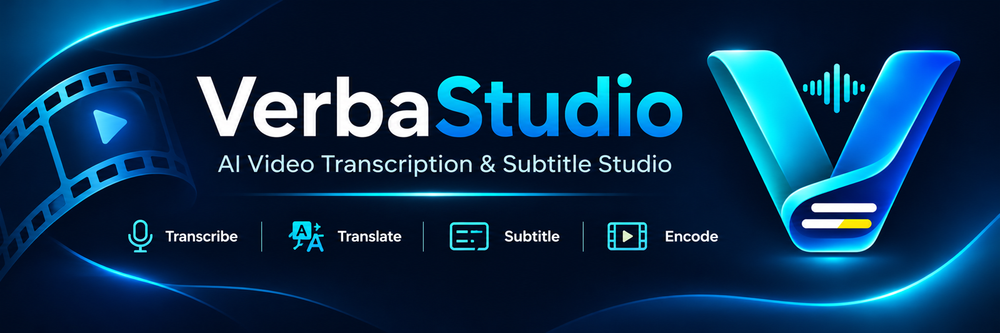

<div align="center">



### VerbaStudio
**From speech to subtitles. All on your device.**<br>
A local command-line pipeline for word-timestamped transcription, Hebrew translation,
RTL-aware ASS captions, ffmpeg burning, and subtitle QA.

<br>

<a href="#-quick-start"></a>
<a href="#-features"></a>
<a href="#-architecture"></a>
<a href="#️-command-line"></a>

<br><br>


</div>

---

## 📑 Table of Contents

<table>
<tr>
<td valign="top" width="33%">

**Getting Started**

- [✨ Features](#-features)
- [🧠 Architecture](#-architecture)
- [🚀 Quick Start](#-quick-start)

</td>
<td valign="top" width="33%">

**Operation**

- [⌨️ Command Line](#️-command-line)
- [🔧 Configuration Matrix](#-configuration-matrix)
- [🧱 Project Structure](#-project-structure)

</td>
<td valign="top" width="33%">

**Reference**

- [💡 Design Decisions](#-design-decisions)
- [⚠️ Known Limitations](#️-known-limitations)
- 📜 License & Credits

</td>
</tr>
</table>

---

## ✨ Features

<table>
<tr>
<td width="33%" valign="top">

### 🎙️ Word-timed transcription
`faster-whisper` produces word timestamps with the
`Systran/faster-whisper-large-v3` model by default.
</td>
<td width="33%" valign="top">

### 🗣️ Local translation
Each translatable cue is sent to an OpenAI-compatible server; atomic content is
passed through. Chat, completion, and prompt-driven API modes are supported.
</td>
<td width="33%" valign="top">

### 📖 Glossary control
The built-in `data/glossary.yml` mapping is always loaded.
An optional YAML mapping can extend or override its entries.
</td>
</tr>
<tr>
<td width="33%" valign="top">

### ✂️ Four cue modes
Choose sentence, clause, progressive reveal, or legacy word cues.
The pipeline verifies that normalization loses no transcript words.
</td>
<td width="33%" valign="top">

### 🎨 Four caption presets
Use `box`, `capcut`, `card`, or `broadcast` ASS styling.
CapCut and broadcast presets highlight words as they enter.
</td>
<td width="33%" valign="top">

### ↔️ RTL-aware rendering
Latin runs are isolated inside Hebrew lines, RTL runs are reordered
for highlighted captions, and trailing punctuation receives an RLM.
</td>
</tr>
<tr>
<td width="33%" valign="top">

### 📐 Caption-band avoidance
The input is sampled for existing burned-in captions.
Automatic placement keeps the new subtitle band out of their way.
</td>
<td width="33%" valign="top">

### 🎬 Bounded video output
ffmpeg burns ASS through libass, prefers NVENC, and falls back to
libx264. A size budget can trigger a 25% dimension reduction.
</td>
<td width="33%" valign="top">

### 🔎 QA artifacts
JSON and Markdown reports cover reading speed, timing boundaries,
silence overlap, translation failures, and layout conflicts.
</td>
</tr>
<tr>
<td width="33%" valign="top">

### ♻️ Content-addressed cache
`--keep` enables a cache keyed by video bytes and behavior-changing
settings. `--force` bypasses a matching cached run.
</td>
<td width="33%" valign="top">

### 🧾 Machine-readable runs
`--json` emits a run manifest, while `--progress` appends stage
updates as JSON Lines for an external process to follow.
</td>
<td width="33%" valign="top">

### 🧪 Tested pipeline
As of this writing, the repository test suite contains 282 passing
tests and 1 skipped test across transcription, layout, burn, and QA.
</td>
</tr>
</table>

---

## 🧠 Architecture

`hs.cli` coordinates media probing, audio extraction, transcription, translation, cue
construction, subtitle generation, burning, caching, and QA. The modules keep those
stages separate so their behavior can be tested without running the complete pipeline.

```text
input video
    |
    v
probe media -> restore cache when enabled and valid
    |                         |
    | cache miss              | cache hit
    v                         v
extract audio -> transcribe   restore artifacts
    |
    v
translate -> assemble cues -> write ASS + SRT -> write QA -> burn video
```

On a cache miss, the pipeline extracts mono 16 kHz PCM audio, releases the Whisper
model after transcription, and then creates the translation client.

---

## 🚀 Quick Start

Management is command-line only. There is no GUI.

Repository: [github.com/Omer-Dahan/VerbaStudio](https://github.com/Omer-Dahan/VerbaStudio).

The repository has no install manifest. Create an environment and install its runtime
imports directly until packaging metadata is added:

```bash
python -m venv .venv
source .venv/bin/activate
python -m pip install faster-whisper PyYAML
```

Provide `ffmpeg` and `ffprobe` on `PATH`; ffmpeg must include libass, FriBidi, and
HarfBuzz. The defaults also expect a CUDA-capable GPU and its runtime libraries.

Start an OpenAI-compatible translation server at `http://127.0.0.1:8189`, then run
the command from the repository root:

```bash
python -m hs input.mp4
```

The default output is `input.subtitled.mp4`. Add `--keep` to retain artifacts and
enable cache reuse. The built-in help is the authoritative command reference:

```bash
python -m hs --help
```

---

## ⌨️ Command Line

The command line is the only management interface. It accepts one positional video.

**Input and output**

- `video` selects the input video.
- `-o, --output` accepts an `.mp4` path or output directory.
- `--dry-run` skips the burn; add `--keep` to retain its ASS, SRT, and QA artifacts.
- `--srt-only` skips the burn; add `--keep` to retain its SRT, ASS, and QA artifacts.
- `--keep` retains subtitle and QA artifacts and enables the cache.
- `--force` ignores a matching cache entry.
- `--json`, `--progress`, and `--verbose` expose machine output, stage updates, and underlying errors.

**Model and transcription**

- `--model`, `--language`, `--device`, and `--compute-type` configure `faster-whisper`.
- The default model is `Systran/faster-whisper-large-v3` with `int8_float16` compute on `cuda`.

**Translation**

- `--no-translate` leaves source text in the cues.
- `--translate-mode`, `--api-base`, and `--server-wait` configure the compatible server.
- `--glossary` overlays another YAML mapping on the built-in glossary.
- `--gender` adds a masculine or feminine speaker hint to translation requests.

**Layout**

- `--cue-style` selects `sentences`, `clauses`, `reveal`, or `words`.
- `--min-cue-duration` controls the minimum duration used by word-cue normalization.
- `--cue-min-seconds`, `--max-cue-words`, and `--min-cue-words` tune clause cues.
- `--position`, `--margin-v`, and `--ignore-caption-band` control vertical placement.

**Caption style**

- `--caption-style` defaults to `capcut` and also accepts `box`, `card`, or `broadcast`.
- `--caption-pop` controls the CapCut per-word entrance animation.
- `--font`, `--size-scale`, `--box-alpha`, and `--outline` control ASS appearance.

**QA and output constraints**

- `--strict` returns exit code 7 when timing or reading-speed violations remain.
- A detected layout conflict also returns exit code 7 unless placement is explicitly overridden.
- `--max-size-mb` sets the output budget; `0` selects constant-quality video encoding.

---

## 🔧 Configuration Matrix

| Flag or file | Group | Behavior | Default |
|---|---|---|---|
| `video` | Input | Input media path | Required |
| `-o`, `--output` | Output | `.mp4` path or directory | `<stem>.subtitled.mp4` |
| `--model` | Model | Whisper model name or path | `Systran/faster-whisper-large-v3` |
| `--language` | Model | Fix source language | Auto-detect, `en` or `he` |
| `--device` | Model | CTranslate2 device | `cuda` |
| `--compute-type` | Model | CTranslate2 numeric format | `int8_float16` |
| `--no-translate` | Translation | Skip translation | Off |
| `--translate-mode` | Translation | Server request format | `chat` |
| `--api-base` | Translation | OpenAI-compatible base URL | `http://127.0.0.1:8189` |
| `--server-wait` | Translation | Health-check wait in seconds | `300` |
| `data/glossary.yml` | Translation | Built-in replacement mapping | Always loaded |
| `--glossary` | Translation | Additional YAML mapping | None |
| `--gender` | Translation | Speaker-form hint | None, `m` or `f` |
| `--cue-style` | Layout | Cue assembly mode | `sentences` |
| `--min-cue-duration` | Layout | Word-cue minimum seconds | `0.40` |
| `--cue-min-seconds` | Layout | Clause minimum seconds; `0` disables | `0` |
| `--max-cue-words` | Layout | Clause word cap; `0` disables | `0` |
| `--min-cue-words` | Layout | Merge undersized clauses; `0` disables | `2` |
| `--position` | Layout | Vertical placement | `auto` |
| `--margin-v` | Layout | ASS vertical margin override | None |
| `--ignore-caption-band` | Layout | Permit overlap with detected captions | Off |
| `--caption-style` | Style | Visual preset | `capcut` |
| `--caption-pop` | Style | CapCut entrance animation | `subtle` |
| `--font` | Style | ASS font family | `Heebo` |
| `--size-scale` | Style | Frame-derived font-size multiplier | `1.20` |
| `--box-alpha` | Style | Box opacity; `0` uses outline | `0.55` |
| `--outline` | Style | Outline width when box opacity is `0` | `2.0` |
| `--max-size-mb` | Output | Size budget; `0` uses constant quality | `9.0` |
| `--dry-run` | Output | Skip burn; artifacts persist with `--keep` | Off |
| `--srt-only` | Output | Skip burn; artifacts persist with `--keep` | Off |
| `--keep` | Output | Persist artifacts and enable cache | Off |
| `--force` | Output | Bypass cache restore | Off |
| `--json` | Reporting | Print final JSON manifest | Off |
| `--progress` | Reporting | Append JSONL stage events | None |
| `--verbose` | Reporting | Include wrapped error details | Off |
| `--strict` | QA | Fail on timing or reading-speed findings | Off |

---

## 🧱 Project Structure

```text
hs/                     Core Python package, about 3.5k lines
  cli.py                 Argument parsing and pipeline orchestration
  transcribe.py          faster-whisper loading and word timestamps
  translate.py           Compatible-server client, retries, and glossary
  segment.py             Sentence, clause, and word segmentation
  cues.py                Cue normalization and reading-speed control
  ass.py                 ASS presets, animation, wrapping, and bidi handling
  burn.py                NVENC/libx264 burn and output-size decisions
  qa.py                  JSON and Markdown quality reports
  cache.py               Content-addressed artifact cache
data/glossary.yml        Built-in translation replacements
fonts/                   Caption fonts used by the included presets
scripts/                 Direction and highlight diagnostic utilities
tests/                   Unit and integration-style pipeline tests
```

---

## 💡 Design Decisions

- **Transcribe before constructing the translator**: the Whisper model is explicitly released and the CUDA cache is cleared first, leaving GPU memory available to a local translation server.
- **Translate sentences, then derive display cues**: sentence-level context stays intact while clause and reveal modes reshape translated text for display.
- **Preserve every transcript word**: the pipeline compares normalized cue words with the original transcript and stops with exit code 7 if any word is lost or duplicated.
- **Make bidi behavior explicit**: Latin runs use Unicode isolates, highlighted RTL runs use display order, and punctuation gets a trailing RLM before libass renders the ASS file.
- **Treat QA as an artifact**: every completed subtitle build writes both machine-readable JSON and a short Markdown report before video encoding begins.
- **Mark generated output**: burned videos receive `hebsub` metadata so the tool can reject accidental repeat processing.

---

## ⚠️ Known Limitations

- **No packaged installation**: there is no `pyproject.toml`, dependency lockfile, or published package workflow yet.
- **GPU-first defaults**: the default `cuda` and `int8_float16` combination requires a compatible CUDA environment. Override the model settings for another supported CTranslate2 setup.
- **External translation service**: translation requires an already-running OpenAI-compatible server unless `--no-translate` is used. The default manifest labels this engine as llama.cpp, but the repository does not install or manage it.
- **ffmpeg feature requirements**: subtitle burning depends on ffmpeg with libass, FriBidi, and HarfBuzz support. NVENC is attempted first, with libx264 as the video fallback.
- **Audio is re-encoded**: inputs with audio are normally encoded as 96 kbps AAC-LC. Source-audio copying is only a fallback when AAC encoding fails.
- **An audio stream is required**: an input without one stops before transcription with exit code 3.
- **Cache is opt-in and artifact-only**: `--keep` enables it, and normal burn reuse requires the output video to remain in place. The cache restores subtitle and QA artifacts, not the video.
- **Translation tolerates isolated failures**: failed cues pass through as source text; the run aborts when failures exceed the larger of three cues or 10% of all cues.
- **Caption detection is heuristic**: the tool samples twelve scaled frames for changing white pixels in the lower image region; use explicit placement or `--ignore-caption-band` when that heuristic does not match the source.

---

## 📜 License & Credits

Released under the [MIT License](LICENSE): you may use, modify, and redistribute this
project, including commercially, as long as the copyright notice and this license
travel with it. The software is provided as is, without warranty.

The project depends on the external `faster-whisper` project, an OpenAI-compatible
translation server, ffmpeg/ffprobe, libass, FriBidi, and HarfBuzz. The optional
`--glossary` file is user-supplied input and is not bundled or licensed by this
repository.

The repository bundles only font families under the OFL: Alef, Assistant, David
Libre, Frank Ruhl Libre, Heebo, Open Sans Hebrew, and Rubik. Install these fonts
system-wide: the tool resolves fonts through fontconfig, not from `fonts/`.
Commercial families such as Almoni, Ploni, and Stanga are not distributed with the
project.
